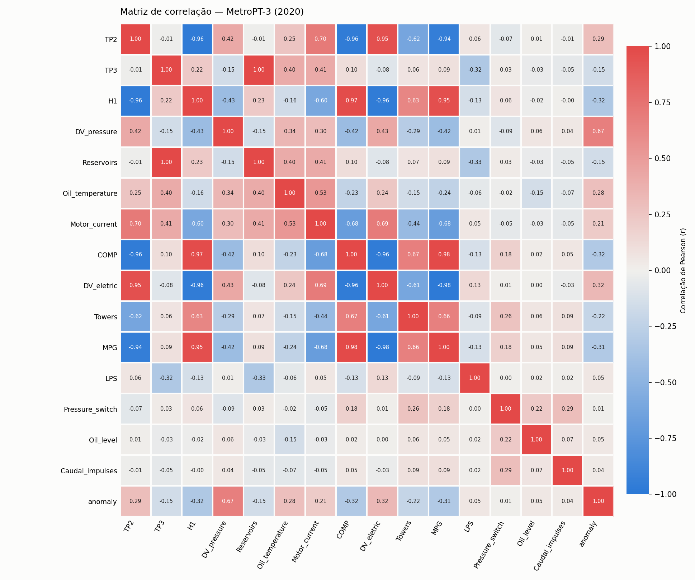
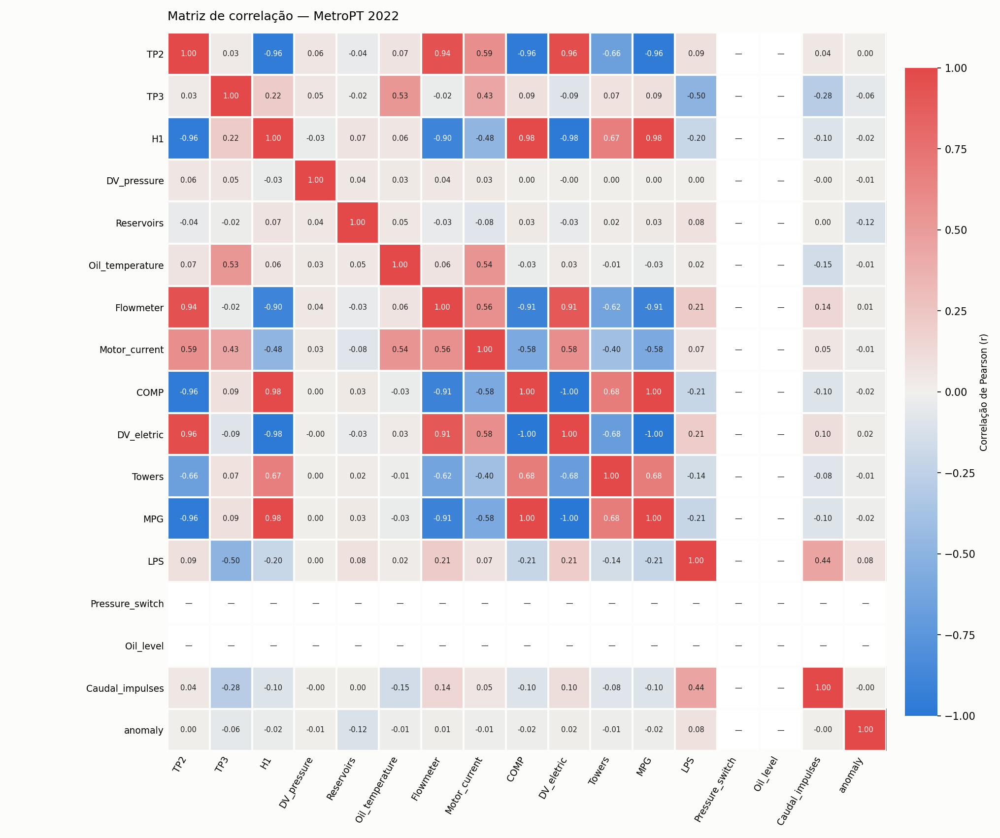
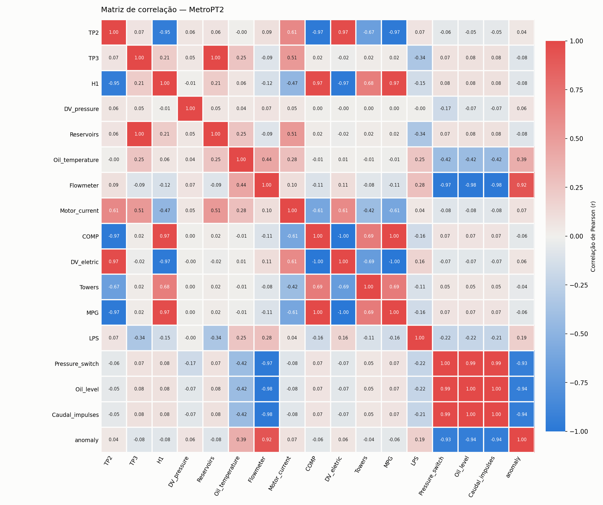

# Matriz de correlação dos atributos — MetroPT-3, MetroPT 2022 e MetroPT2

> Gerado por `python -m src.correlation_matrix` (apps/ml). Não edite à mão.

Correlação de Pearson entre **todas as colunas de atributos** de cada dataset (sensores analógicos, sinais digitais e o rótulo de falha `anomaly`), calculada sobre **todas as linhas** a 10 s, sem amostragem. Colunas de controle (`timestamp`, índice, marcação de dataset) não são atributos e ficam de fora. Coluna constante no dataset não tem correlação definida: aparece como **—**.

Leitura: |r| ≥ 0,8 = correlação forte (atributos quase redundantes); o sinal indica se sobem juntos (+) ou em sentidos opostos (−). Correlação linear não mede relação causal nem relação não linear.

## MetroPT-3 (2020)

1.516.948 linhas · 16 atributos

| | `TP2` | `TP3` | `H1` | `DV_pressure` | `Reservoirs` | `Oil_temperature` | `Motor_current` | `COMP` | `DV_eletric` | `Towers` | `MPG` | `LPS` | `Pressure_switch` | `Oil_level` | `Caudal_impulses` | `anomaly` |
|---|---:|---:|---:|---:|---:|---:|---:|---:|---:|---:|---:|---:|---:|---:|---:|---:|
| `TP2` | 1.00 | -0.01 | -0.96 | 0.41 | -0.01 | 0.25 | 0.70 | -0.96 | 0.95 | -0.62 | -0.94 | 0.06 | -0.07 | 0.01 | -0.01 | 0.29 |
| `TP3` | -0.01 | 1.00 | 0.22 | -0.15 | 1.00 | 0.40 | 0.41 | 0.10 | -0.08 | 0.06 | 0.09 | -0.32 | 0.03 | -0.03 | -0.05 | -0.15 |
| `H1` | -0.96 | 0.22 | 1.00 | -0.43 | 0.23 | -0.16 | -0.60 | 0.97 | -0.96 | 0.63 | 0.95 | -0.13 | 0.06 | -0.02 | -0.00 | -0.32 |
| `DV_pressure` | 0.41 | -0.15 | -0.43 | 1.00 | -0.15 | 0.34 | 0.30 | -0.42 | 0.43 | -0.29 | -0.42 | 0.01 | -0.09 | 0.06 | 0.04 | 0.67 |
| `Reservoirs` | -0.01 | 1.00 | 0.23 | -0.15 | 1.00 | 0.40 | 0.41 | 0.10 | -0.08 | 0.07 | 0.09 | -0.33 | 0.03 | -0.03 | -0.05 | -0.15 |
| `Oil_temperature` | 0.25 | 0.40 | -0.16 | 0.34 | 0.40 | 1.00 | 0.53 | -0.23 | 0.24 | -0.15 | -0.24 | -0.06 | -0.02 | -0.15 | -0.07 | 0.28 |
| `Motor_current` | 0.70 | 0.41 | -0.60 | 0.30 | 0.41 | 0.53 | 1.00 | -0.68 | 0.69 | -0.44 | -0.68 | 0.05 | -0.05 | -0.03 | -0.05 | 0.21 |
| `COMP` | -0.96 | 0.10 | 0.97 | -0.42 | 0.10 | -0.23 | -0.68 | 1.00 | -0.96 | 0.67 | 0.98 | -0.13 | 0.18 | 0.02 | 0.05 | -0.32 |
| `DV_eletric` | 0.95 | -0.08 | -0.96 | 0.43 | -0.08 | 0.24 | 0.69 | -0.96 | 1.00 | -0.61 | -0.98 | 0.13 | 0.01 | 0.00 | -0.03 | 0.32 |
| `Towers` | -0.62 | 0.06 | 0.63 | -0.29 | 0.07 | -0.15 | -0.44 | 0.67 | -0.61 | 1.00 | 0.66 | -0.09 | 0.26 | 0.06 | 0.09 | -0.22 |
| `MPG` | -0.94 | 0.09 | 0.95 | -0.42 | 0.09 | -0.24 | -0.68 | 0.98 | -0.98 | 0.66 | 1.00 | -0.13 | 0.18 | 0.05 | 0.09 | -0.31 |
| `LPS` | 0.06 | -0.32 | -0.13 | 0.01 | -0.33 | -0.06 | 0.05 | -0.13 | 0.13 | -0.09 | -0.13 | 1.00 | 0.00 | 0.02 | 0.02 | 0.05 |
| `Pressure_switch` | -0.07 | 0.03 | 0.06 | -0.09 | 0.03 | -0.02 | -0.05 | 0.18 | 0.01 | 0.26 | 0.18 | 0.00 | 1.00 | 0.22 | 0.29 | 0.01 |
| `Oil_level` | 0.01 | -0.03 | -0.02 | 0.06 | -0.03 | -0.15 | -0.03 | 0.02 | 0.00 | 0.06 | 0.05 | 0.02 | 0.22 | 1.00 | 0.07 | 0.05 |
| `Caudal_impulses` | -0.01 | -0.05 | -0.00 | 0.04 | -0.05 | -0.07 | -0.05 | 0.05 | -0.03 | 0.09 | 0.09 | 0.02 | 0.29 | 0.07 | 1.00 | 0.04 |
| `anomaly` | 0.29 | -0.15 | -0.32 | 0.67 | -0.15 | 0.28 | 0.21 | -0.32 | 0.32 | -0.22 | -0.31 | 0.05 | 0.01 | 0.05 | 0.04 | 1.00 |

**Pares fortemente correlacionados (|r| ≥ 0.8):**

| Atributo A | Atributo B | r |
|---|---|---:|
| `TP3` | `Reservoirs` | +1.00 |
| `COMP` | `MPG` | +0.98 |
| `DV_eletric` | `MPG` | -0.98 |
| `H1` | `COMP` | +0.97 |
| `TP2` | `H1` | -0.96 |
| `COMP` | `DV_eletric` | -0.96 |
| `H1` | `DV_eletric` | -0.96 |
| `TP2` | `COMP` | -0.96 |
| `H1` | `MPG` | +0.95 |
| `TP2` | `DV_eletric` | +0.95 |
| `TP2` | `MPG` | -0.94 |

**Atributos mais correlacionados com o rótulo de falha (`anomaly`):** `DV_pressure` (+0.67), `DV_eletric` (+0.32), `H1` (-0.32), `COMP` (-0.32), `MPG` (-0.31)

## MetroPT 2022

1.077.495 linhas · 17 atributos · constantes (sem correlação): `Pressure_switch`, `Oil_level`

| | `TP2` | `TP3` | `H1` | `DV_pressure` | `Reservoirs` | `Oil_temperature` | `Flowmeter` | `Motor_current` | `COMP` | `DV_eletric` | `Towers` | `MPG` | `LPS` | `Pressure_switch` | `Oil_level` | `Caudal_impulses` | `anomaly` |
|---|---:|---:|---:|---:|---:|---:|---:|---:|---:|---:|---:|---:|---:|---:|---:|---:|---:|
| `TP2` | 1.00 | 0.03 | -0.96 | 0.06 | -0.04 | 0.07 | 0.94 | 0.59 | -0.96 | 0.96 | -0.66 | -0.96 | 0.09 | — | — | 0.04 | 0.00 |
| `TP3` | 0.03 | 1.00 | 0.22 | 0.05 | -0.02 | 0.53 | -0.02 | 0.43 | 0.09 | -0.09 | 0.07 | 0.09 | -0.50 | — | — | -0.28 | -0.06 |
| `H1` | -0.96 | 0.22 | 1.00 | -0.03 | 0.07 | 0.06 | -0.90 | -0.48 | 0.98 | -0.98 | 0.67 | 0.98 | -0.20 | — | — | -0.10 | -0.02 |
| `DV_pressure` | 0.06 | 0.05 | -0.03 | 1.00 | 0.04 | 0.03 | 0.04 | 0.03 | 0.00 | -0.00 | 0.00 | 0.00 | 0.00 | — | — | -0.00 | -0.01 |
| `Reservoirs` | -0.04 | -0.02 | 0.07 | 0.04 | 1.00 | 0.05 | -0.03 | -0.08 | 0.03 | -0.03 | 0.02 | 0.03 | 0.08 | — | — | 0.00 | -0.12 |
| `Oil_temperature` | 0.07 | 0.53 | 0.06 | 0.03 | 0.05 | 1.00 | 0.06 | 0.54 | -0.03 | 0.03 | -0.01 | -0.03 | 0.02 | — | — | -0.15 | -0.01 |
| `Flowmeter` | 0.94 | -0.02 | -0.90 | 0.04 | -0.03 | 0.06 | 1.00 | 0.56 | -0.91 | 0.91 | -0.62 | -0.91 | 0.21 | — | — | 0.14 | 0.01 |
| `Motor_current` | 0.59 | 0.43 | -0.48 | 0.03 | -0.08 | 0.54 | 0.56 | 1.00 | -0.58 | 0.58 | -0.40 | -0.58 | 0.07 | — | — | 0.05 | -0.01 |
| `COMP` | -0.96 | 0.09 | 0.98 | 0.00 | 0.03 | -0.03 | -0.91 | -0.58 | 1.00 | -1.00 | 0.68 | 1.00 | -0.21 | — | — | -0.10 | -0.02 |
| `DV_eletric` | 0.96 | -0.09 | -0.98 | -0.00 | -0.03 | 0.03 | 0.91 | 0.58 | -1.00 | 1.00 | -0.68 | -1.00 | 0.21 | — | — | 0.10 | 0.02 |
| `Towers` | -0.66 | 0.07 | 0.67 | 0.00 | 0.02 | -0.01 | -0.62 | -0.40 | 0.68 | -0.68 | 1.00 | 0.68 | -0.14 | — | — | -0.08 | -0.01 |
| `MPG` | -0.96 | 0.09 | 0.98 | 0.00 | 0.03 | -0.03 | -0.91 | -0.58 | 1.00 | -1.00 | 0.68 | 1.00 | -0.21 | — | — | -0.10 | -0.02 |
| `LPS` | 0.09 | -0.50 | -0.20 | 0.00 | 0.08 | 0.02 | 0.21 | 0.07 | -0.21 | 0.21 | -0.14 | -0.21 | 1.00 | — | — | 0.44 | 0.08 |
| `Pressure_switch` | — | — | — | — | — | — | — | — | — | — | — | — | — | — | — | — | — |
| `Oil_level` | — | — | — | — | — | — | — | — | — | — | — | — | — | — | — | — | — |
| `Caudal_impulses` | 0.04 | -0.28 | -0.10 | -0.00 | 0.00 | -0.15 | 0.14 | 0.05 | -0.10 | 0.10 | -0.08 | -0.10 | 0.44 | — | — | 1.00 | -0.00 |
| `anomaly` | 0.00 | -0.06 | -0.02 | -0.01 | -0.12 | -0.01 | 0.01 | -0.01 | -0.02 | 0.02 | -0.01 | -0.02 | 0.08 | — | — | -0.00 | 1.00 |

**Pares fortemente correlacionados (|r| ≥ 0.8):**

| Atributo A | Atributo B | r |
|---|---|---:|
| `COMP` | `MPG` | +1.00 |
| `DV_eletric` | `MPG` | -1.00 |
| `COMP` | `DV_eletric` | -1.00 |
| `H1` | `DV_eletric` | -0.98 |
| `H1` | `COMP` | +0.98 |
| `H1` | `MPG` | +0.98 |
| `TP2` | `DV_eletric` | +0.96 |
| `TP2` | `COMP` | -0.96 |
| `TP2` | `MPG` | -0.96 |
| `TP2` | `H1` | -0.96 |
| `TP2` | `Flowmeter` | +0.94 |
| `Flowmeter` | `COMP` | -0.91 |
| `Flowmeter` | `DV_eletric` | +0.91 |
| `Flowmeter` | `MPG` | -0.91 |
| `H1` | `Flowmeter` | -0.90 |

**Atributos mais correlacionados com o rótulo de falha (`anomaly`):** `Reservoirs` (-0.12), `LPS` (+0.08), `TP3` (-0.06), `H1` (-0.02), `DV_eletric` (+0.02)

## MetroPT2

705.563 linhas · 17 atributos

| | `TP2` | `TP3` | `H1` | `DV_pressure` | `Reservoirs` | `Oil_temperature` | `Flowmeter` | `Motor_current` | `COMP` | `DV_eletric` | `Towers` | `MPG` | `LPS` | `Pressure_switch` | `Oil_level` | `Caudal_impulses` | `anomaly` |
|---|---:|---:|---:|---:|---:|---:|---:|---:|---:|---:|---:|---:|---:|---:|---:|---:|---:|
| `TP2` | 1.00 | 0.07 | -0.95 | 0.06 | 0.06 | -0.00 | 0.09 | 0.61 | -0.97 | 0.97 | -0.67 | -0.97 | 0.07 | -0.06 | -0.05 | -0.05 | 0.04 |
| `TP3` | 0.07 | 1.00 | 0.21 | 0.05 | 1.00 | 0.25 | -0.09 | 0.51 | 0.02 | -0.02 | 0.02 | 0.02 | -0.34 | 0.07 | 0.08 | 0.08 | -0.08 |
| `H1` | -0.95 | 0.21 | 1.00 | -0.01 | 0.21 | 0.06 | -0.12 | -0.47 | 0.97 | -0.97 | 0.68 | 0.97 | -0.15 | 0.08 | 0.08 | 0.08 | -0.08 |
| `DV_pressure` | 0.06 | 0.05 | -0.01 | 1.00 | 0.05 | 0.04 | 0.07 | 0.05 | 0.00 | -0.00 | 0.00 | 0.00 | -0.00 | -0.17 | -0.07 | -0.07 | 0.06 |
| `Reservoirs` | 0.06 | 1.00 | 0.21 | 0.05 | 1.00 | 0.25 | -0.09 | 0.51 | 0.02 | -0.02 | 0.02 | 0.02 | -0.34 | 0.07 | 0.08 | 0.08 | -0.08 |
| `Oil_temperature` | -0.00 | 0.25 | 0.06 | 0.04 | 0.25 | 1.00 | 0.44 | 0.28 | -0.01 | 0.01 | -0.01 | -0.01 | 0.25 | -0.42 | -0.42 | -0.42 | 0.39 |
| `Flowmeter` | 0.09 | -0.09 | -0.12 | 0.07 | -0.09 | 0.44 | 1.00 | 0.10 | -0.11 | 0.11 | -0.08 | -0.11 | 0.28 | -0.97 | -0.98 | -0.98 | 0.92 |
| `Motor_current` | 0.61 | 0.51 | -0.47 | 0.05 | 0.51 | 0.28 | 0.10 | 1.00 | -0.61 | 0.61 | -0.42 | -0.61 | 0.04 | -0.08 | -0.08 | -0.08 | 0.07 |
| `COMP` | -0.97 | 0.02 | 0.97 | 0.00 | 0.02 | -0.01 | -0.11 | -0.61 | 1.00 | -1.00 | 0.69 | 1.00 | -0.16 | 0.07 | 0.07 | 0.07 | -0.06 |
| `DV_eletric` | 0.97 | -0.02 | -0.97 | -0.00 | -0.02 | 0.01 | 0.11 | 0.61 | -1.00 | 1.00 | -0.69 | -1.00 | 0.16 | -0.07 | -0.07 | -0.07 | 0.06 |
| `Towers` | -0.67 | 0.02 | 0.68 | 0.00 | 0.02 | -0.01 | -0.08 | -0.42 | 0.69 | -0.69 | 1.00 | 0.69 | -0.11 | 0.05 | 0.05 | 0.05 | -0.04 |
| `MPG` | -0.97 | 0.02 | 0.97 | 0.00 | 0.02 | -0.01 | -0.11 | -0.61 | 1.00 | -1.00 | 0.69 | 1.00 | -0.16 | 0.07 | 0.07 | 0.07 | -0.06 |
| `LPS` | 0.07 | -0.34 | -0.15 | -0.00 | -0.34 | 0.25 | 0.28 | 0.04 | -0.16 | 0.16 | -0.11 | -0.16 | 1.00 | -0.22 | -0.22 | -0.21 | 0.19 |
| `Pressure_switch` | -0.06 | 0.07 | 0.08 | -0.17 | 0.07 | -0.42 | -0.97 | -0.08 | 0.07 | -0.07 | 0.05 | 0.07 | -0.22 | 1.00 | 0.99 | 0.99 | -0.93 |
| `Oil_level` | -0.05 | 0.08 | 0.08 | -0.07 | 0.08 | -0.42 | -0.98 | -0.08 | 0.07 | -0.07 | 0.05 | 0.07 | -0.22 | 0.99 | 1.00 | 1.00 | -0.94 |
| `Caudal_impulses` | -0.05 | 0.08 | 0.08 | -0.07 | 0.08 | -0.42 | -0.98 | -0.08 | 0.07 | -0.07 | 0.05 | 0.07 | -0.21 | 0.99 | 1.00 | 1.00 | -0.94 |
| `anomaly` | 0.04 | -0.08 | -0.08 | 0.06 | -0.08 | 0.39 | 0.92 | 0.07 | -0.06 | 0.06 | -0.04 | -0.06 | 0.19 | -0.93 | -0.94 | -0.94 | 1.00 |

**Pares fortemente correlacionados (|r| ≥ 0.8):**

| Atributo A | Atributo B | r |
|---|---|---:|
| `COMP` | `MPG` | +1.00 |
| `TP3` | `Reservoirs` | +1.00 |
| `COMP` | `DV_eletric` | -1.00 |
| `DV_eletric` | `MPG` | -1.00 |
| `Oil_level` | `Caudal_impulses` | +1.00 |
| `Pressure_switch` | `Oil_level` | +0.99 |
| `Pressure_switch` | `Caudal_impulses` | +0.99 |
| `Flowmeter` | `Oil_level` | -0.98 |
| `Flowmeter` | `Caudal_impulses` | -0.98 |
| `H1` | `COMP` | +0.97 |
| `H1` | `MPG` | +0.97 |
| `H1` | `DV_eletric` | -0.97 |
| `Flowmeter` | `Pressure_switch` | -0.97 |
| `TP2` | `COMP` | -0.97 |
| `TP2` | `MPG` | -0.97 |
| `TP2` | `DV_eletric` | +0.97 |
| `TP2` | `H1` | -0.95 |
| `Oil_level` | `anomaly` | -0.94 |
| `Caudal_impulses` | `anomaly` | -0.94 |
| `Pressure_switch` | `anomaly` | -0.93 |
| `Flowmeter` | `anomaly` | +0.92 |

**Atributos mais correlacionados com o rótulo de falha (`anomaly`):** `Oil_level` (-0.94), `Caudal_impulses` (-0.94), `Pressure_switch` (-0.93), `Flowmeter` (+0.92), `Oil_temperature` (+0.39)

## Observações

* Atributo mais correlacionado com o rótulo, por dataset: MetroPT-3 (2020): `DV_pressure` (+0.67); MetroPT 2022: `Reservoirs` (-0.12); MetroPT2: `Oil_level` (-0.94). O sinal que acompanha a falha muda de um dataset para outro: no MetroPT-3, `DV_pressure` vem de três vazamentos de ar de 2020 (ver [`event_correlation.md`](../../event_correlation.md)); no MetroPT2, `Oil_level` vale 0 em todas as 23.156 linhas em falha e em só 2.880 linhas normais (é praticamente o rótulo). `Oil_level` fica fora dos modelos porque é constante no MetroPT 2022 (sem informação para treinar) — usá-lo seria aprender um sinal que o treino não contém. No MetroPT 2022 nenhum atributo bruto passa de |r| = 0,12 com o rótulo.
* Os sinais digitais `COMP`, `DV_eletric` e `MPG` e as pressões `TP2`/`H1` se movem juntos (|r| ≥ 0,9): descrevem o mesmo ciclo carga/alívio do compressor.
* `Reservoirs` e `TP3` medem a mesma pressão no MetroPT-3 e no MetroPT2 (r ≈ 1), mas não no MetroPT 2022 — um dos motivos de `Reservoirs` ficar fora dos modelos (ver [`datasets.md`](../../datasets.md)).
* `Flowmeter` só existe nos datasets de 2022.
