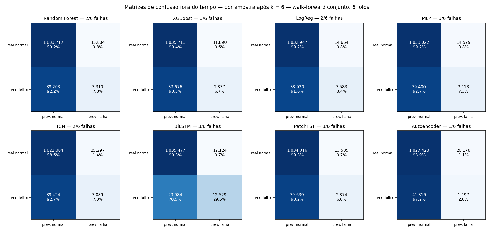
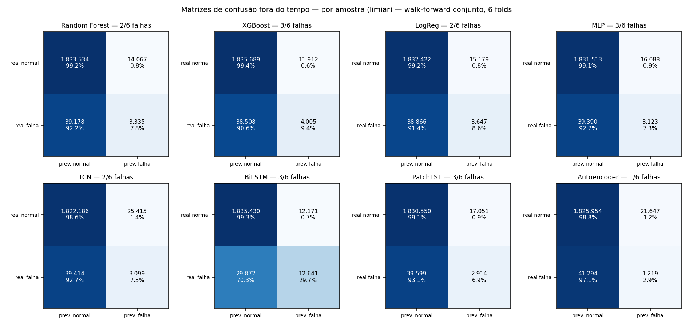

# Avaliação de doutorado de todos os modelos — protocolo aninhado

> Gerado por `python -m src.render_nested_report` a partir de `apps/ml/models/nested/*.json`. Não edite à mão.

## Protocolo

* **Dados**: MetroPT-3 (2020) + MetroPT 2022, sensores harmonizados (sem `Reservoirs`/`Oil_level`, que mudam de significado entre os datasets).
* **Loop externo**: walk-forward purgado por evento, 7 falhas → **6 folds fora do tempo**; cada fold treina só com o passado e é testado numa falha que o modelo nunca viu.
* **Loop interno** (só nos dados de treino): leave-one-failure-out para (i) escolher os hiperparâmetros pelo custo esperado RN-02, (ii) calibrar por Platt e (iii) escolher o limiar sobre a probabilidade calibrada. Os parâmetros antigos do Optuna (escolhidos num split aleatório) foram descartados.
* **Mesmo protocolo para os 8 modelos**, árvores e redes; **3 seeds** (a seed 0 escolhe os hiperparâmetros, as seeds 1–2 medem a variância do treino). Balanceamento de classes só no treino; teste na prevalência real.
* **Fold 1** tem uma única falha de treino: não há o que validar internamente, então usa os hiperparâmetros padrão e limiar a priori (registrado como *fallback*).

## Por evento — 6 falhas fora do tempo, média de 3 seeds

| Modelo | Artefato | Falhas detectadas (média [mín; máx]) | Episódios de falso alarme | Custo esperado médio | ECE bruto → calibrado |
|---|---|---|---|---|---|
| Random Forest | `random_forest_v3` | **2.0** [2; 2] | 48 | 74.7 | 0.033 → 0.033 |
| XGBoost | `xgboost_v3` | **2.7** [2; 3] | 37 | 61.7 | 0.028 → 0.036 |
| LogReg | `—` | **2.0** [2; 2] | 63 | 77.2 | 0.026 → 0.039 |
| MLP | `mlp_v3` | **3.0** [3; 3] | 179 | 79.8 | 0.029 → 0.037 |
| TCN | `tcn_v3` | **2.0** [2; 2] | 154 | 92.3 | 0.022 → 0.035 |
| BiLSTM | `bilstm_v3` | **3.0** [3; 3] | 45 | 57.6 | 0.028 → 0.034 |
| PatchTST | `patchtst_v3` | **3.0** [3; 3] | 66 | 61.0 | 0.033 → 0.038 |
| Autoencoder | `autoencoder_v3` | **1.0** [1; 1] | 203 | 117.1 | — |

## Matrizes de confusão — por amostra após k = 6 (seed 0)

| Modelo | TP | FP | FN | TN | Precisão | Recall | Especificidade | F1 |
|---|---|---|---|---|---|---|---|---|
| Random Forest | 3.310 | 13.884 | 39.203 | 1.833.717 | 19.3% | 7.8% | 99.2% | 11.1% |
| XGBoost | 2.837 | 11.890 | 39.676 | 1.835.711 | 19.3% | 6.7% | 99.4% | 9.9% |
| LogReg | 3.583 | 14.654 | 38.930 | 1.832.947 | 19.6% | 8.4% | 99.2% | 11.8% |
| MLP | 3.113 | 14.579 | 39.400 | 1.833.022 | 17.6% | 7.3% | 99.2% | 10.3% |
| TCN | 3.089 | 25.297 | 39.424 | 1.822.304 | 10.9% | 7.3% | 98.6% | 8.7% |
| BiLSTM | 12.529 | 12.124 | 29.984 | 1.835.477 | 50.8% | 29.5% | 99.3% | 37.3% |
| PatchTST | 2.874 | 13.585 | 39.639 | 1.834.016 | 17.5% | 6.8% | 99.3% | 9.7% |
| Autoencoder | 1.197 | 20.178 | 41.316 | 1.827.423 | 5.6% | 2.8% | 98.9% | 3.7% |

Por amostra no limiar, sem persistência: 

## Detecção por falha (seed 0) e hiperparâmetros escolhidos

| Modelo | fold 1 | fold 2 | fold 3 | fold 4 | fold 5 | fold 6 |
|---|---|---|---|---|---|---|
| Random Forest | ✅ `max_depth=20, min_samples_leaf=1, max_features=sqrt` | ❌ `max_depth=20, min_samples_leaf=1, max_features=sqrt, pos_weight_scale=0.25` | ❌ `max_depth=None, min_samples_leaf=20, max_features=sqrt` | ✅ `max_depth=20, min_samples_leaf=1, max_features=sqrt, pos_weight_scale=0.25` | ❌ `max_depth=20, min_samples_leaf=1, max_features=sqrt, neg_stride=1` | ❌ `max_depth=20, min_samples_leaf=1, max_features=sqrt, neg_stride=1` |
| XGBoost | ✅ `max_depth=6, learning_rate=0.1, n_estimators=300, subsample=0.9, colsample_bytree=0.8` | ✅ `max_depth=6, learning_rate=0.2, n_estimators=150, subsample=0.7, colsample_bytree=0.5` | ❌ `max_depth=6, learning_rate=0.1, n_estimators=300, subsample=0.9, colsample_bytree=0.8, neg_stride=1` | ✅ `max_depth=6, learning_rate=0.1, n_estimators=300, subsample=0.9, colsample_bytree=0.8` | ❌ `max_depth=4, learning_rate=0.05, n_estimators=600, subsample=0.8, colsample_bytree=0.6` | ❌ `max_depth=6, learning_rate=0.2, n_estimators=150, subsample=0.7, colsample_bytree=0.5` |
| LogReg | ✅ `C=1.0` | ❌ `C=1.0` | ❌ `C=1.0, pos_weight_scale=0.25` | ✅ `C=1.0, pos_weight_scale=0.25` | ❌ `C=0.01` | ❌ `C=1.0, pos_weight_scale=0.25` |
| MLP | ✅ `epochs=8, lr=0.001` | ✅ `epochs=8, lr=0.001, pos_weight_scale=0.25` | ❌ `epochs=8, lr=0.001, neg_stride=1` | ✅ `epochs=8, lr=0.001, neg_stride=1` | ❌ `epochs=8, lr=0.001, neg_stride=1` | ❌ `epochs=8, lr=0.001, pos_weight_scale=0.25` |
| TCN | ✅ `epochs=8, lr=0.001` | ❌ `epochs=16, lr=0.0003` | ❌ `epochs=8, lr=0.001` | ✅ `epochs=8, lr=0.001, pos_weight_scale=0.25` | ❌ `epochs=16, lr=0.0003` | ❌ `epochs=8, lr=0.001, pos_weight_scale=0.25` |
| BiLSTM | ✅ `epochs=8, lr=0.001` | ✅ `epochs=8, lr=0.001, pos_weight_scale=0.25` | ❌ `epochs=8, lr=0.001, pos_weight_scale=0.25` | ✅ `epochs=8, lr=0.001` | ❌ `epochs=8, lr=0.001` | ❌ `epochs=8, lr=0.001, pos_weight_scale=0.25` |
| PatchTST | ✅ `epochs=8, lr=0.001` | ✅ `epochs=8, lr=0.001` | ❌ `epochs=8, lr=0.001, neg_stride=5` | ✅ `epochs=8, lr=0.001, pos_weight_scale=0.25` | ❌ `epochs=8, lr=0.001, pos_weight_scale=0.25` | ❌ `epochs=8, lr=0.001, pos_weight_scale=0.25` |
| Autoencoder | ❌ `epochs=8, lr=0.001` | ❌ `epochs=8, lr=0.001, neg_stride=2` | ❌ `epochs=8, lr=0.001` | ✅ `epochs=8, lr=0.001, neg_stride=2` | ❌ `epochs=16, lr=0.0003` | ❌ `epochs=8, lr=0.001, neg_stride=2` |

Folds 1–3: falhas 2–4 de 2020. Folds 4–6: as 3 falhas de 2022 (vazamento de ar nos consumidores, válvula do secador de ar, vazamento de óleo).

## Gate RN-05 contra o champion (`random_forest_v3`)

Wilcoxon unilateral pareado por fold (custo médio das 3 seeds); p mínimo atingível com 6 folds = 0,016.

| Candidato | Melhora mediana | p | Promove? |
|---|---|---|---|
| XGBoost | +0.0 | 0.625 | não |
| LogReg | -1.5 | 1.000 | não |
| MLP | +0.0 | 0.750 | não |
| TCN | +0.0 | 1.000 | não |
| BiLSTM | +0.2 | 0.188 | não |
| PatchTST | +0.0 | 0.438 | não |
| Autoencoder | +0.0 | 1.000 | não |

## Sensibilidade às escolhas de avaliação (k, horizonte, razão de custo)

Grade: k ∈ [3, 6, 12], horizonte ∈ [2.0, 6.0, 12.0] h, C_FN/C_FP ∈ [10.0, 100.0, 1000.0] — 27 configurações; o limiar é re-escolhido nas predições out-of-fold calibradas de cada configuração (sem retreino).

* Estabilidade do ranking por custo (τ de Kendall contra a referência k = 6, 6 h, 100): mediana **0.29**, mínimo 0.07.
* Melhor modelo por configuração: LogReg em 6, Autoencoder em 6, BiLSTM em 6, XGBoost em 3, MLP em 3, PatchTST em 3.

| Modelo | Falhas detectadas (mín–máx entre configurações) |
|---|---|
| Random Forest | 1.0 – 2.0 |
| XGBoost | 1.0 – 3.0 |
| LogReg | 2.0 – 3.0 |
| MLP | 2.0 – 3.0 |
| TCN | 2.0 – 2.0 |
| BiLSTM | 1.0 – 3.0 |
| PatchTST | 1.7 – 3.0 |
| Autoencoder | 0.0 – 4.3 |

## Incerteza — conformal estático × adaptativo (ACI), alvo 90%

Conjunto de calibração = predições out-of-fold calibradas (só treino); fluxo de teste fora do tempo. Hipótese: o rótulo de cada linha fica conhecido logo depois (na operação, chega com o veredito da OS).

| Modelo | Cobertura da classe falha: estático → ACI | Cobertura normal: estático → ACI | Tamanho médio do conjunto: estático → ACI |
|---|---|---|---|
| Random Forest | 0.66 → **0.91** | 0.89 → 0.90 | 1.08 → 1.22 |
| XGBoost | 0.53 → **0.90** | 0.88 → 0.90 | 0.89 → 0.94 |
| LogReg | 0.42 → **0.89** | 0.76 → 0.90 | 0.77 → 1.17 |
| MLP | 0.15 → **0.89** | 0.90 → 0.90 | 0.96 → 1.12 |
| TCN | 0.21 → **0.89** | 0.92 → 0.90 | 0.94 → 1.21 |
| BiLSTM | 0.30 → **0.89** | 0.88 → 0.90 | 0.95 → 1.23 |
| PatchTST | 0.12 → **0.88** | 0.91 → 0.90 | 0.96 → 1.19 |
| Autoencoder | 0.56 → **0.91** | 0.95 → 0.90 | 1.10 → 1.18 |

## RUL com as 7 falhas (6 folds)

* XGBoost AFT: C-index 0.48 [0.45; 0.51].
* Baseline de renovação: C-index 0.65 [0.52; 0.81].

Com 7 falhas o tempo até a falha continua não aprendível pelas features (C-index ≈ 0,5): o resultado negativo do RF-30 se mantém com o dobro de folds.
