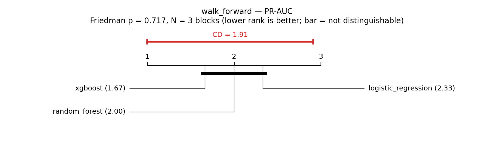
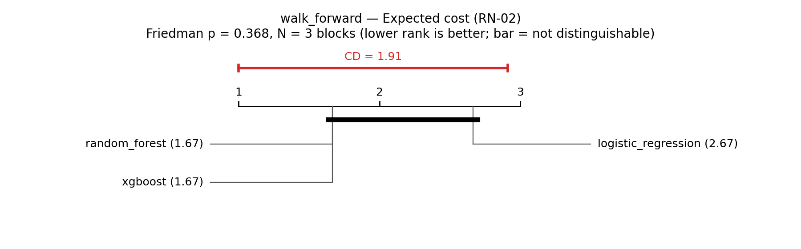
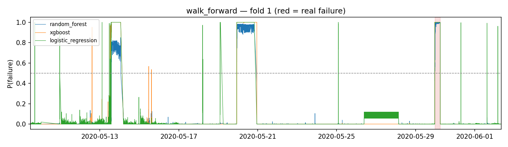
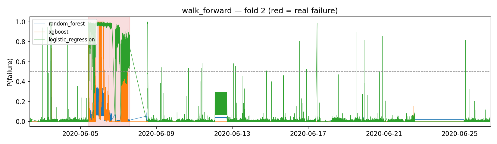
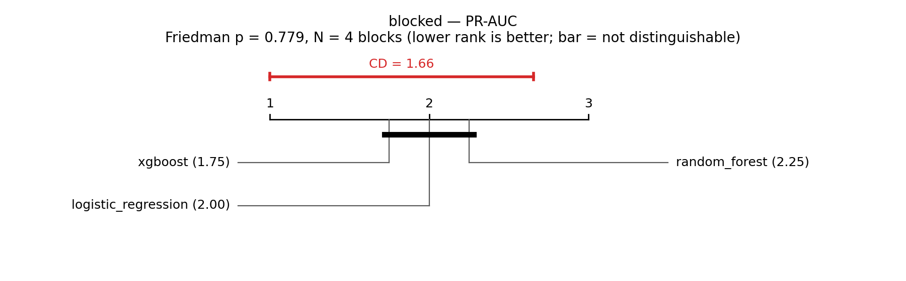
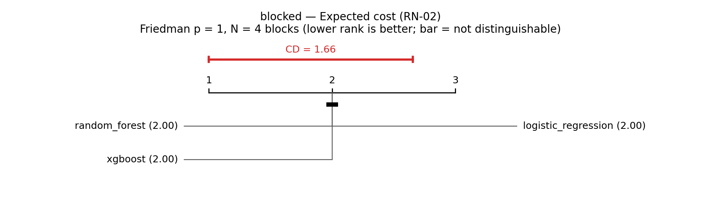
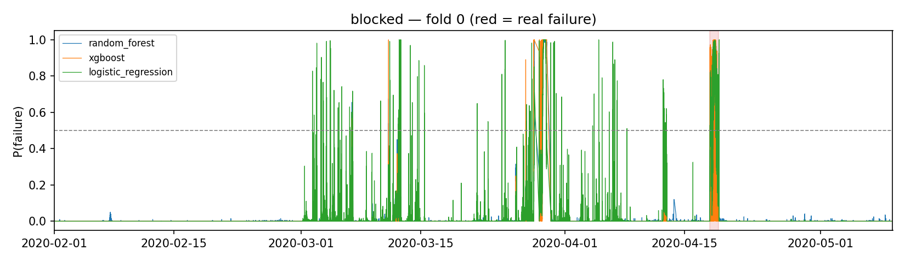
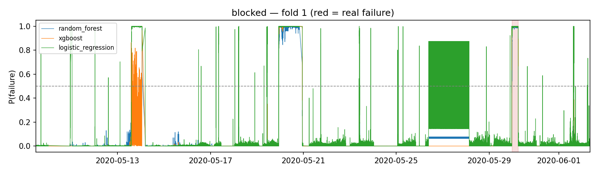
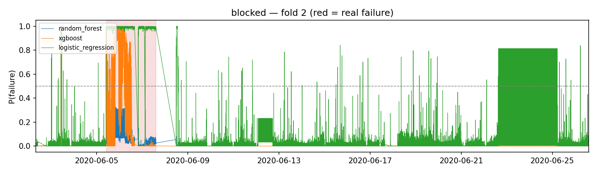
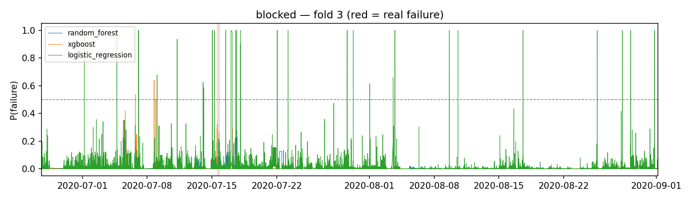

# Temporal evaluation — RF-28 / RF-29 / RNF-79

> Generated by `python -m src.render_temporal_report` from `apps/ml/models/eval_temporal.json` — do not edit by hand.

Evaluated at `2026-10-15T00:34:53.689212+00:00` · 80 features · seeds [0, 1, 2, 3, 4] · negatives subsampled 1/5 in training only · purge 300 s · embargo 3600 s · persistence k=6 (RN-03) · early horizon 6 h · min lead 2 h (RN-01) · C_FN=100, C_FP=1 (RN-02).

Values are `mean [95 % bootstrap CI]` over every (fold, seed) run.

## Legacy protocol (stratified random 80/20 — leaks)

| Model | ROC-AUC | PR-AUC | F1@0.5 |
|---|---|---|---|
| Random Forest | 1.0000 | 0.9992 | 0.9751 |
| XGBoost | 1.0000 | 0.9996 | 0.9809 |
| Logistic Regression | 0.9937 | 0.7090 | 0.7045 |

## Walk-forward with purge (PRIMARY — never trains on the future)

3 folds.

### Summary

| Model | PR-AUC | ROC-AUC | Event recall | Range-F1 | False alarms / day | Expected cost (RN-02) | Lead time |
|---|---|---|---|---|---|---|---|
| Random Forest | 0.587 [0.428, 0.739] | 0.957 [0.931, 0.980] | 0.667 [0.400, 0.867] | 0.153 [0.082, 0.227] | 0.28 [0.13, 0.45] | 50.40 [30.73, 70.27] | +0.92 h [+0.47, +1.36] (n=10) |
| XGBoost | 0.400 [0.283, 0.543] | 0.970 [0.963, 0.978] | 0.667 [0.400, 0.867] | 0.315 [0.182, 0.453] | 0.08 [0.03, 0.13] | 35.27 [14.87, 61.07] | +0.13 h [+0.08, +0.18] (n=10) |
| Logistic Regression | 0.331 [0.155, 0.547] | 0.927 [0.903, 0.952] | 0.667 [0.400, 0.867] | 0.256 [0.135, 0.388] | 0.18 [0.11, 0.25] | 38.00 [17.80, 63.20] | +0.17 h [+0.15, +0.20] (n=10) |

### Per-failure detection

| Fold (test failure) | Model | Detected (fixed 0.5) | Detected (inner) | Lead time (inner) | FA/day (inner) | Threshold (inner) | Detected (oracle) |
|---|---|---|---|---|---|---|---|
| 1 (2020-05-29 23:30) | Random Forest | 5/5 | 5/5 | +0.18 h | 0.13 | 0.50 | 5/5 |
| 1 (2020-05-29 23:30) | XGBoost | 5/5 | 5/5 | +0.21 h | 0.21 | 0.50 | 5/5 |
| 1 (2020-05-29 23:30) | Logistic Regression | 5/5 | 5/5 | +0.22 h | 0.38 | 0.50 | 5/5 |
| 2 (2020-06-05 10:00) | Random Forest | 0/5 | 0/5 | — | 0.00 | 0.70, 0.80, 0.85 | 5/5 |
| 2 (2020-06-05 10:00) | XGBoost | 5/5 | 5/5 | +0.05 h | 0.01 | 0.65, 0.75, 0.80, 0.95 | 5/5 |
| 2 (2020-06-05 10:00) | Logistic Regression | 5/5 | 5/5 | +0.13 h | 0.12 | 0.10 | 5/5 |
| 3 (2020-07-15 14:30) | Random Forest | 0/5 | 5/5 | +1.65 h | 0.72 | 0.10 | 5/5 |
| 3 (2020-07-15 14:30) | XGBoost | 0/5 | 0/5 | — | 0.01 | 0.25, 0.55, 0.70, 0.90, 0.95 | 5/5 |
| 3 (2020-07-15 14:30) | Logistic Regression | 0/5 | 0/5 | — | 0.03 | 0.85 | 0/5 |

### Calibration and conformal coverage (RF-31)

Target coverage per class: ≥ 0.90 (Mondrian conformal, α = 0.1). Calibration set = training out-of-fold scores; runs without one are excluded from the conformal columns.

| Model | ECE (all runs) | ECE after isotonic (runs with calibration set) | Brier | Coverage normal | Coverage failure | Empty sets | Conformal runs |
|---|---|---|---|---|---|---|---|
| Random Forest | 0.054 | 0.048 | 0.049 | 0.947 | 0.586 | 0.067 | 10/15 |
| XGBoost | 0.051 | 0.037 | 0.050 | 0.885 | 0.677 | 0.074 | 10/15 |
| Logistic Regression | 0.033 | 0.032 | 0.030 | 0.482 | 0.492 | 0.485 | 10/15 |

### Friedman + Nemenyi (blocks = folds, seeds averaged)

| Metric | Friedman χ² | p | CD | Average ranks |
|---|---|---|---|---|
| PR-AUC | 0.67 | 0.717 | 1.91 | XGBoost 1.67, Random Forest 2.00, Logistic Regression 2.33 |
| ROC-AUC | 0.67 | 0.717 | 1.91 | Random Forest 1.67, XGBoost 2.00, Logistic Regression 2.33 |
| Event recall | 0.00 | 1.000 | 1.91 | Random Forest 2.00, XGBoost 2.00, Logistic Regression 2.00 |
| Range-F1 | 1.27 | 0.529 | 1.91 | Random Forest 1.67, XGBoost 1.83, Logistic Regression 2.50 |
| False alarms / day | 2.00 | 0.368 | 1.91 | Random Forest 1.67, XGBoost 1.67, Logistic Regression 2.67 |
| Expected cost (RN-02) | 2.00 | 0.368 | 1.91 | Random Forest 1.67, XGBoost 1.67, Logistic Regression 2.67 |

Wilcoxon RF vs XGBoost (paired over folds):

- PR-AUC: p = 1.000
- ROC-AUC: p = 1.000
- Event recall: p = 1.000
- Range-F1: p = 1.000
- False alarms / day: p = 1.000
- Expected cost (RN-02): p = 1.000

## Leave-one-event-segment-out with purge + embargo (secondary)

4 folds.

### Summary

| Model | PR-AUC | ROC-AUC | Event recall | Range-F1 | False alarms / day | Expected cost (RN-02) | Lead time |
|---|---|---|---|---|---|---|---|
| Random Forest | 0.371 [0.298, 0.452] | 0.960 [0.941, 0.977] | 0.750 [0.550, 0.900] | 0.236 [0.149, 0.328] | 0.33 [0.22, 0.44] | 45.60 [30.45, 61.70] | +0.17 h [-0.42, +0.76] (n=15) |
| XGBoost | 0.429 [0.337, 0.530] | 0.979 [0.972, 0.984] | 0.750 [0.550, 0.900] | 0.313 [0.188, 0.438] | 0.67 [0.14, 1.27] | 43.85 [25.35, 62.95] | -2.49 h [-4.97, -0.53] (n=15) |
| Logistic Regression | 0.377 [0.225, 0.541] | 0.947 [0.926, 0.968] | 0.750 [0.550, 0.900] | 0.309 [0.208, 0.410] | 0.22 [0.14, 0.31] | 33.25 [17.15, 51.50] | -2.59 h [-4.80, -0.92] (n=15) |

### Per-failure detection

| Fold (test failure) | Model | Detected (fixed 0.5) | Detected (inner) | Lead time (inner) | FA/day (inner) | Threshold (inner) | Detected (oracle) |
|---|---|---|---|---|---|---|---|
| 0 (2020-04-18 00:00) | Random Forest | 5/5 | 5/5 | -1.22 h | 0.27 | 0.55, 0.60, 0.65 | 5/5 |
| 0 (2020-04-18 00:00) | XGBoost | 5/5 | 5/5 | -7.72 h | 0.15 | 0.90, 0.95 | 5/5 |
| 0 (2020-04-18 00:00) | Logistic Regression | 5/5 | 5/5 | -8.11 h | 0.14 | 0.80 | 5/5 |
| 1 (2020-05-29 23:30) | Random Forest | 5/5 | 5/5 | +0.08 h | 0.25 | 0.35, 0.40, 0.90 | 5/5 |
| 1 (2020-05-29 23:30) | XGBoost | 5/5 | 5/5 | +0.19 h | 2.41 | 0.05, 0.60 | 5/5 |
| 1 (2020-05-29 23:30) | Logistic Regression | 5/5 | 5/5 | +0.21 h | 0.55 | 0.95 | 5/5 |
| 2 (2020-06-05 10:00) | Random Forest | 0/5 | 0/5 | — | 0.07 | 0.15, 0.20, 0.25, 0.85 | 5/5 |
| 2 (2020-06-05 10:00) | XGBoost | 5/5 | 5/5 | +0.07 h | 0.11 | 0.05, 0.15, 0.30 | 5/5 |
| 2 (2020-06-05 10:00) | Logistic Regression | 5/5 | 5/5 | +0.14 h | 0.16 | 0.20 | 5/5 |
| 3 (2020-07-15 14:30) | Random Forest | 0/5 | 5/5 | +1.65 h | 0.72 | 0.10 | 5/5 |
| 3 (2020-07-15 14:30) | XGBoost | 0/5 | 0/5 | — | 0.01 | 0.25, 0.55, 0.70, 0.90, 0.95 | 5/5 |
| 3 (2020-07-15 14:30) | Logistic Regression | 0/5 | 0/5 | — | 0.03 | 0.85 | 0/5 |

### Calibration and conformal coverage (RF-31)

Target coverage per class: ≥ 0.90 (Mondrian conformal, α = 0.1). Calibration set = training out-of-fold scores; runs without one are excluded from the conformal columns.

| Model | ECE (all runs) | ECE after isotonic (runs with calibration set) | Brier | Coverage normal | Coverage failure | Empty sets | Conformal runs |
|---|---|---|---|---|---|---|---|
| Random Forest | 0.039 | 0.036 | 0.038 | 0.909 | 0.807 | 0.070 | 20/20 |
| XGBoost | 0.035 | 0.032 | 0.033 | 0.892 | 0.774 | 0.057 | 20/20 |
| Logistic Regression | 0.036 | 0.036 | 0.030 | 0.664 | 0.535 | 0.176 | 20/20 |

### Friedman + Nemenyi (blocks = folds, seeds averaged)

| Metric | Friedman χ² | p | CD | Average ranks |
|---|---|---|---|---|
| PR-AUC | 0.50 | 0.779 | 1.66 | XGBoost 1.75, Logistic Regression 2.00, Random Forest 2.25 |
| ROC-AUC | 0.50 | 0.779 | 1.66 | Random Forest 1.75, XGBoost 2.00, Logistic Regression 2.25 |
| Event recall | 0.00 | 1.000 | 1.66 | Random Forest 2.00, XGBoost 2.00, Logistic Regression 2.00 |
| Range-F1 | 0.13 | 0.936 | 1.66 | Logistic Regression 1.88, Random Forest 2.00, XGBoost 2.12 |
| False alarms / day | 0.00 | 1.000 | 1.66 | Random Forest 2.00, XGBoost 2.00, Logistic Regression 2.00 |
| Expected cost (RN-02) | 0.00 | 1.000 | 1.66 | Random Forest 2.00, XGBoost 2.00, Logistic Regression 2.00 |

Wilcoxon RF vs XGBoost (paired over folds):

- PR-AUC: p = 0.375
- ROC-AUC: p = 0.625
- Event recall: p = 1.000
- Range-F1: p = 1.000
- False alarms / day: p = 1.000
- Expected cost (RN-02): p = 1.000

